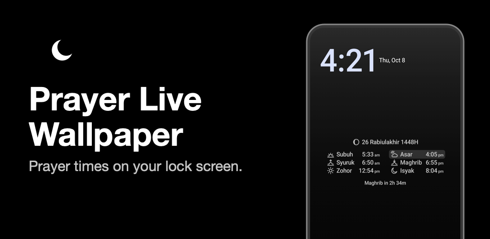
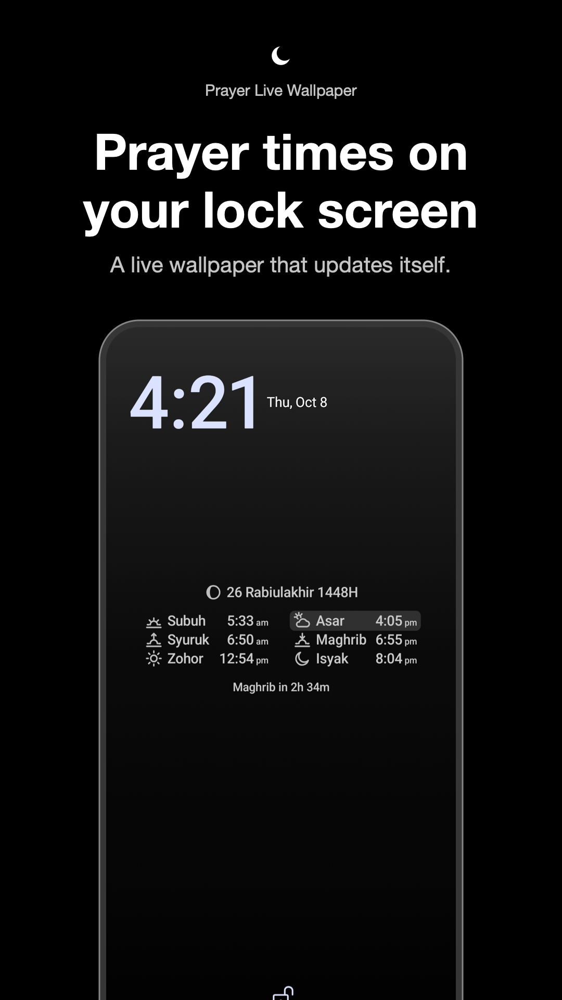
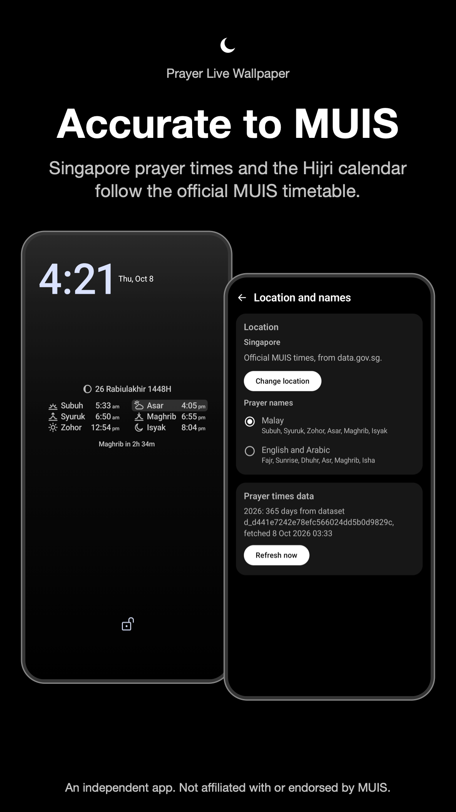
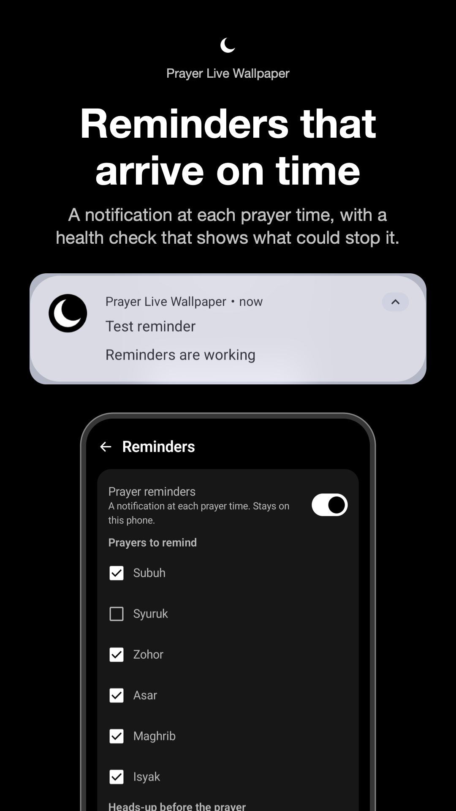
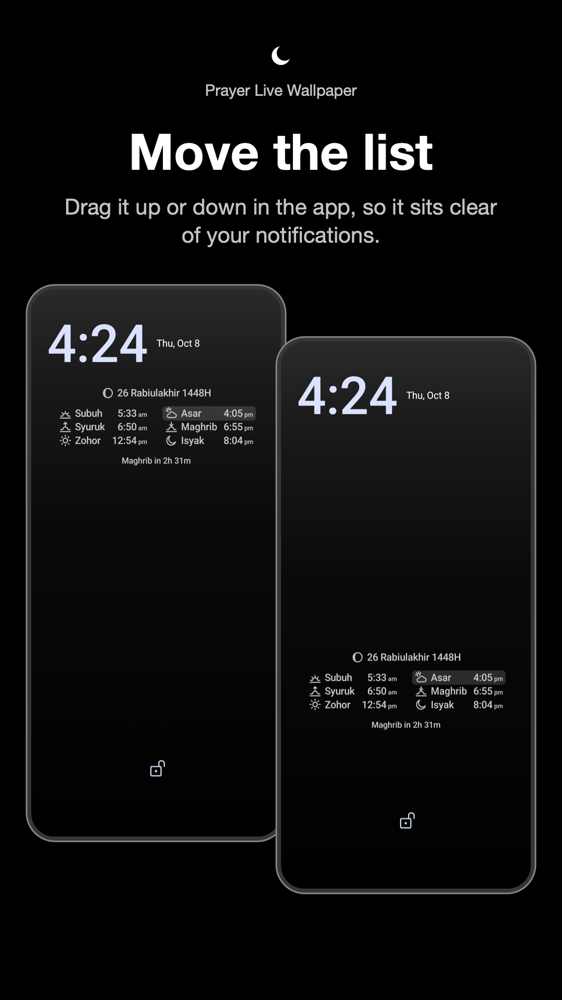
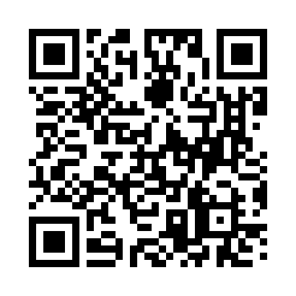

  

<h1 align="center">Prayer Live Wallpaper</h1>

  Prayer times on your Android lock screen. Free, no ads, no account.

  <a href="https://hafizuddin-a.github.io/prayer-lockscreen/download/"><b>Download</b></a> ·
  <a href="docs/DEVELOPING.md"><b>Build it</b></a> ·
  <a href="https://hafizuddin-a.github.io/prayer-lockscreen/"><b>Privacy</b></a> ·
  <a href="LICENSE"><b>MIT License</b></a>

  

<table>
  <tr>
    <td></td>
    <td></td>
    <td></td>
    <td></td>
  </tr>
</table>

## Get it

Open the **[download page](https://hafizuddin-a.github.io/prayer-lockscreen/download/)** on your phone, or scan this:

Needs Android 14 or newer. The page walks through the few steps Android asks for. The app checks GitHub once a month for a new version and shows an **Update** button when there is one (switch it off under About).

## What it does

- **Lock screen list.** Six times, the current prayer marked, and a countdown to the next.
- **Singapore or anywhere.** Singapore uses the official MUIS timetable and Hijri dates. About 34,000 other cities are calculated on the phone.
- **Reminders and widgets.** Optional notifications at each prayer, and three home screen widgets.
- **Easier reading.** Larger text, high contrast, bold, and screen reader support.
- **Your look.** A gradient, a colour or your own photo, and you place the list where you like.
- **Private.** Nothing is collected. Times for other places never touch the network.

## For developers

| | |
|---|---|
| [docs/DEVELOPING.md](docs/DEVELOPING.md) | Build, sign, release, debug tools, yearly upkeep |
| [docs/HOW_IT_WORKS.md](docs/HOW_IT_WORKS.md) | Where each part of the code lives and why |
| [docs/play/RELEASE_STEPS.md](docs/play/RELEASE_STEPS.md) | GitHub releases, Google's developer verification, keeping the signing key safe, Google Play |
| [SECURITY.md](SECURITY.md) | Reporting a problem, checking a download |

`tools/build-sideload.sh` builds an APK you can install yourself (signed with the debug key, so it can't update to the release APK without uninstalling first).

**Known limits.** Checked on an Android 16 emulator and in unit tests; one real phone so far. Widgets can redraw up to about ten minutes late. The Hijri table runs to 27 January 2028. Calculated times can differ from a local mosque by a few minutes.

## Licence and credits

Code, docs and graphics are under the [MIT License](LICENSE). Three things keep their own terms:

- **MUIS data.** The Hijri month starts and Islamic events follow the Muis Calendar and are used with MUIS's agreement. They are MUIS's data, not MIT. The Singapore timetable is downloaded from data.gov.sg under the Singapore Open Data Licence.
- **Cities.** `cities.tsv` comes from GeoNames (CC BY 4.0).
- **Libraries.** AndroidX, Compose, WorkManager, Kotlin (Apache 2.0) and Adhan (MIT).

Not affiliated with or endorsed by MUIS. Calculated times are not an official timetable.
